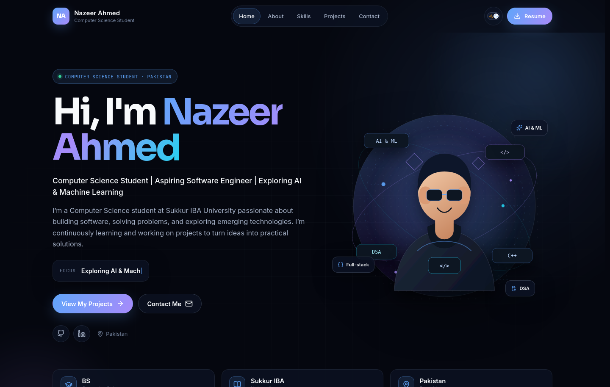
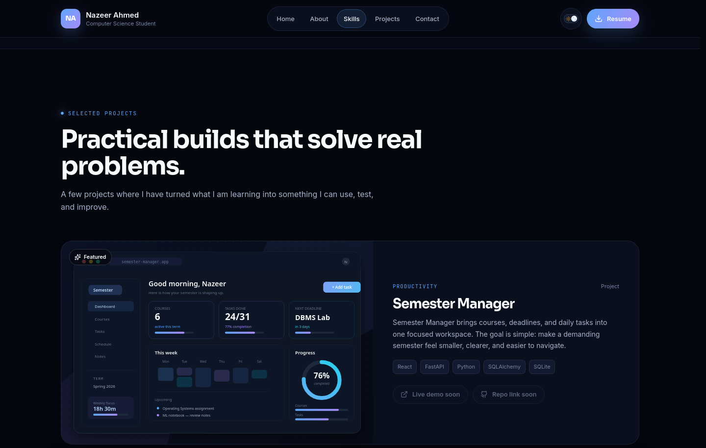
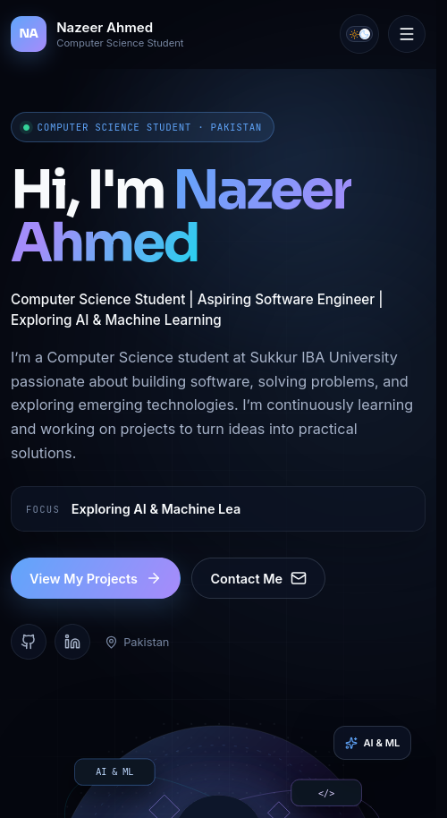

# Nazeer Ahmed — Personal Portfolio

A modern, responsive personal portfolio for **Nazeer Ahmed**, a Computer Science student at **Sukkur IBA University**. The site brings together an introduction, technical skills, selected projects, education, and contact information in a fast, accessible React experience.

## Live Website

> **Production URL:** **https://nazeer-ahmed-portfolio.vercel.app**

## GitHub Repository

> https://github.com/nazeer-ahmed-cs/nazeer-ahmed-portfolio

## About the Project

This portfolio is designed to feel like a professional developer product rather than a static résumé page. It uses a deep navy dark theme with a blue-to-violet accent system, subtle gradients, modern card layouts, scroll-reveal animations, and a lightweight typing effect in the hero.

The project is built with **React 19**, **Vite**, and **Lucide React**, with plain, maintainable CSS. No UI framework or unnecessary dependency is used. A clean light theme is included as well, with the user's preference stored locally.

## Features

- Responsive sticky navigation with active-section highlighting and a mobile menu
- Animated hero with a typing effect, call-to-action buttons, and social links
- About section with a two-column layout, interests, and strengths
- Skills grouped into Programming Languages, Frontend, Database, and Tools
- Project cards with technology tags and clearly marked "coming soon" links where no public URL exists
- Education timeline with no invented grades, awards, or graduation dates
- Contact section with real social links and a frontend-only demo form
- Dark/light theme toggle with `localStorage` persistence
- Print-friendly `public/resume.html` page
- Scroll-reveal animations and hover transitions
- Full `prefers-reduced-motion` support
- Semantic HTML, accessible labels, skip link, and meaningful image alt text
- SEO metadata, Open Graph tags, and a custom favicon
- No horizontal scrolling from 320px upward

## Technologies Used

| Category | Technology |
| --- | --- |
| Framework | React 19 |
| Build tool | Vite 8 |
| Language | JavaScript (ES modules) |
| Styling | CSS3, custom properties |
| Icons | Lucide React + custom inline brand icons |
| Fonts | Google Fonts (Sora, Inter, JetBrains Mono) |
| Linting | Oxlint |
| Version control | Git and GitHub |
| Deployment | Vercel |

## Project Structure

```text
nazeer-ahmed-portfolio/
├── docs/
│   └── screenshots/
│       ├── home-desktop.png
│       ├── home-mobile.png
│       └── projects-desktop.png
├── public/
│   ├── favicon.svg
│   ├── about-illustration.svg
│   ├── profile-illustration.svg
│   ├── project-semester-manager.svg
│   ├── project-sysmonitor.svg
│   ├── project-portfolio.svg
│   ├── resume.html
│   └── robots.txt
├── src/
│   ├── components/
│   │   ├── Navbar.jsx
│   │   ├── Hero.jsx
│   │   ├── About.jsx
│   │   ├── Skills.jsx
│   │   ├── Projects.jsx
│   │   ├── ProjectCard.jsx
│   │   ├── Education.jsx
│   │   ├── Contact.jsx
│   │   ├── Footer.jsx
│   │   ├── BrandIcons.jsx
│   │   ├── Reveal.jsx
│   │   ├── SectionHeading.jsx
│   │   ├── SocialLinks.jsx
│   │   └── ThemeToggle.jsx
│   ├── data/
│   │   └── portfolio.js
│   ├── hooks/
│   │   ├── useActiveSection.js
│   │   ├── usePrefersReducedMotion.js
│   │   ├── useScrollReveal.js
│   │   ├── useTheme.js
│   │   └── useTypingEffect.js
│   ├── App.jsx
│   ├── main.jsx
│   └── index.css
├── index.html
├── vercel.json
└── package.json
```

## Getting Started

### Prerequisites

- Node.js **22.x** (see `.nvmrc`)
- npm 10+

### Installation

```bash
git clone https://github.com/nazeer-ahmed-cs/nazeer-ahmed-portfolio.git
cd nazeer-ahmed-portfolio
npm install
```

### Run Locally

```bash
npm run dev
```

Open the local URL printed by Vite (usually `http://localhost:5173`).

### Production Build

```bash
npm run build
npm run preview
```

The production output is generated in `dist/`.

### Lint

```bash
npm run lint
```

## Screenshots

### Desktop



### Projects



### Mobile



## Deployment on Vercel

This repository is configured for Vercel with `vercel.json`:

- Framework: Vite
- Build command: `npm run build`
- Output directory: `dist`
- Install command: `npm install`

### Deploy from the Vercel Dashboard

1. Import the GitHub repository at [vercel.com/new](https://vercel.com/new).
2. Keep the detected Vite settings (or use the values above).
3. Deploy. Every push to `main` will create a new production deployment automatically.

### Deploy with the Vercel CLI

```bash
npx vercel
npx vercel --prod
```

The production site is available at **https://nazeer-ahmed-portfolio.vercel.app**. Pushing to `main` triggers a new production deployment through the Vercel GitHub integration.

## Customizing the Content

Most content lives in **`src/data/portfolio.js`**:

- Profile, email, and social URLs
- Navigation links, roles, interests, and stats
- Skill groups
- Projects and their repository/live links
- Education information

Update the visual assets in **`public/`** and the styles in **`src/index.css`**.

### Link Placeholders

The **Semester Manager** and **SysMonitor** projects intentionally show **"Repo link soon"** and **"Live demo soon"** because no verified public repository or deployment URL exists yet. Add them in `src/data/portfolio.js` when they are ready.

The contact form is a **frontend-only demonstration**. It validates the fields, shows a status message, and never sends or stores data. The note inside the form makes this clear to visitors.

## Contact

- **GitHub:** [github.com/nazeer-ahmed-cs](https://github.com/nazeer-ahmed-cs)
- **LinkedIn:** [linkedin.com/in/nazeer-ahmed-971382327](https://www.linkedin.com/in/nazeer-ahmed-971382327/)
- **GitHub Pages:** [nazeer-ahmed-cs.github.io](https://nazeer-ahmed-cs.github.io)
- **Email:** `nazeerahmedkhaskhelin51l@gmail.com`

## License

This project is personal work by Nazeer Ahmed. You may use the structure and styling as inspiration, but please do not republish the personal content as your own.
